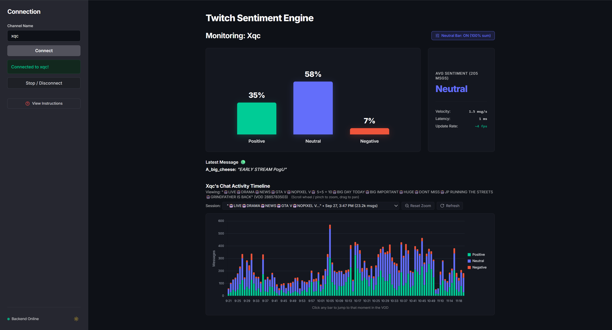

# Real-Time Twitch.tv Chat Analytics Engine

 
 


### [Click for Live Demo](http://ec2-54-196-206-108.compute-1.amazonaws.com/)
> **Note:** If the app appears unresponsive, please refresh the page to reconnect.

### Demo

*A preview of the engine connecting to a live channel and processing messages in real-time.*

---

## About The Project
Real-time sentiment analysis engine for Twitch chat. Standard models fail on live chat due to latency constraints and gaming slang. This project solves both of those issues.

Why it matters:
- **Too slow:** Standard models add 300+ ms per message. Users need <60 ms, especially for rooms that operate at 50+ msgs/sec.
- **Wrong dialect:** "Pog", "throw", "cap" aren't in standard datasets.
## System Design

The pipeline uses three key components:

### 1. Asynchronous Data Ingestion
Twitch chat can spike from 5 to 100 messages/second instantly. Most scrapers freeze or drop packets.

Solution: An `asyncio` + `twitchAPI` pipeline handles WebSocket connections without blocking. Stable even during traffic surges.

---

### 2. Two-Stage Model Development

**Stage 1: Domain Adaptation (MLM)**
Standard models think "He is cracked" means broken. In gaming, it means skilled. Trained RoBERTa on 1.1M unlabeled Twitch messages to "teach" it gaming dialect. Perplexity improved from ~21k to ~5.5.

**Stage 2: Sentiment Fine-Tuning**
Fine-tuned the domain-adapted model on labeled chat logs. Result: Correctly identifies nuances like sarcasm and hype.

---

### 3. Hybrid Cloud/Local Architecture
Training is compute-heavy, but cloud inference APIs are too slow for real-time chat.

- **Training:** MLM pre-training and sentiment fine-tuning on Google Colab (A100 GPU)
- **Inference:** CPU deployment on Hugging Face Spaces, GPU-accelerated locally on RTX 4050 using FP16 mixed precision
- **Performance:** <60ms latency locally, ~200ms on cloud CPU

---

### 4. Swappable Backend & Cloud Storage
The inference engine is decoupled from the UI via a FastAPI layer:
- **Dual-Engine Storage:** Supports zero-dependency local development via SQLite or cloud scaling via Amazon DynamoDB (two-table design for raw logs and minute rollups).
- **Real-Time Streaming:** Broadcasts analyzed sentiment directly to connected web clients over WebSockets.
- **Headless Authentication:** Silent OAuth token auto-refresh with no browser popups, enabling headless container deployment.

## Project Structure

```text
Twitch-Chat-Analysis/
├── backend/                   # FastAPI backend, async workers & ML pipeline
│   ├── api.py                 # REST API endpoints and WebSocket gateway
│   ├── primary.py             # TwitchSentimentWorker & chat stream consumer
│   ├── run.py                 # Development server entry point
│   ├── config.py              # Environment configuration & constants
│   ├── src/
│   │   ├── db_service.py      # Abstracted SQLite and AWS DynamoDB layers
│   │   ├── utils/             # Hugging Face model loader & cache
│   │   └── training/          # MLM pre-training & fine-tuning scripts
│   ├── scripts/               # Twitch OAuth CLI & test scripts
│   └── tests/                 # Unit & integration test suite
├── frontend/                  # Vue 3 + TypeScript + Vite web dashboard
│   ├── src/
│   │   ├── components/        # Live sentiment bars, activity timeline, sidebar
│   │   ├── stores/            # Pinia global reactive state (WebSocket stream)
│   │   ├── services/          # REST and WebSocket client
│   │   └── types/             # TypeScript schemas & sentiment definitions
│   └── README.md              # In-depth frontend guide & architecture overview
├── requirements.txt           # Python backend dependencies & libraries
└── README.md                  # Project overview & quickstart
```

## Tech Stack

- **Language:** Python 3.10+, TypeScript 5+
- **Backend & APIs:** FastAPI, Uvicorn (ASGI), WebSockets, `twitchAPI`
- **ML & NLP:** PyTorch (GPU / CPU), Hugging Face Transformers (Custom RoBERTa)
- **Data & Cloud Storage:** AWS DynamoDB (Boto3), SQLite (`aiosqlite`)
- **Frontend Dashboard:** Vue 3 (Composition API), Vite, Tailwind CSS, Pinia, Chart.js (`vue-chartjs`), Lucide Icons
- **DevOps & Testing:** Docker, Docker Compose, GitHub Actions, Python `unittest`


## Getting Started Locally

### 1. Clone the Repo
```bash
git clone https://github.com/osamuyiohenhen/Twitch-Chat-Analysis.git
cd Twitch-Chat-Analysis
```

### 2. Set up Python Environment
```bash
python -m venv .venv
# Windows
.venv\Scripts\activate
# Mac/Linux
source .venv/bin/activate
```

### 3. Install PyTorch & Backend Dependencies
For NVIDIA GPUs (CUDA acceleration):
```bash
pip install torch --index-url https://download.pytorch.org/whl/cu126
```
For CPU-only environments:
```bash
pip install torch --index-url https://download.pytorch.org/whl/cpu
```
Install backend requirements:
```bash
pip install -r requirements.txt
```

### 4. Configure Environment Variables
Create a `.env` file in `backend/` (or repository root) with your Twitch Developer credentials:
```env
TWITCH_CLIENT_ID=your_twitch_client_id
TWITCH_CLIENT_SECRET=your_twitch_client_secret
```

### 5. Generate Twitch OAuth Tokens
Run the interactive authorization CLI once locally:
```bash
python backend/scripts/auth_twitch.py
```
This launches a browser window to authenticate with Twitch and automatically saves the paired `TWITCH_USER_TOKEN` and long-lived `TWITCH_REFRESH_TOKEN` to your `.env` file for silent auto-refresh.

---

### 6. Run the Application

#### Step A: Start the FastAPI Backend
```bash
cd backend
python run.py
```
*API runs at `http://localhost:8000`. Interactive Swagger docs available at [http://localhost:8000/docs](http://localhost:8000/docs).*

#### Step B: Start the Vue 3 Frontend
Open a separate terminal window:
```bash
cd frontend
npm install
npm run dev
```
*Frontend runs at `http://localhost:5173` with instant hot-module replacement (HMR).*

#### Running Backend Tests
```bash
cd backend
python -m unittest discover -s tests
```

---

## Roadmap

- [x] **Async Ingestion Pipeline:** High-throughput WebSocket scraper using `twitchAPI`
- [x] **Domain Adaptation:** MLM training on Twitch slang
- [x] **Sentiment Fine-Tuning:** Custom 3-class classifier tuned on gaming vernacular
- [x] **Backend Infrastructure:** FastAPI service with REST endpoints, WebSockets, and lifespan model caching
- [x] **Database Abstraction Layer:** Pluggable storage architecture supporting local SQLite and AWS DynamoDB
- [x] **AWS Cloud Deployment:** Production deployment on AWS EC2 with DynamoDB tables
- [x] **Modern Web Frontend:** Responsive Vue 3 + TypeScript dashboard with live streaming charts, activity timeline, and VOD timestamp deep-linking
- [ ] **LoRA Adapters:** Parameter-efficient adapters tailored to specific streamer sub-communities

## Acknowledgements & License

**License:** Apache 2.0.

**Attribution:** This model is a modified and fine-tuned version of [cardiffnlp/twitter-roberta-base-sentiment-latest](https://huggingface.co/cardiffnlp/twitter-roberta-base-sentiment-latest).