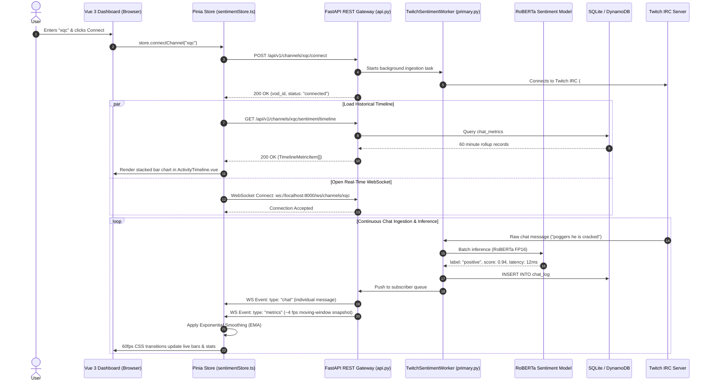

# Twitch Chat Sentiment Dashboard — Comprehensive Frontend Guide & Project Architecture

> **Note for the Author / Maintainer:**  
> This document is an exhaustive, in-depth guide written specifically for you to master the architecture, file structure, design decisions, and technology stack of this frontend. Whether you are revisiting this codebase months from now or learning modern frontend engineering from scratch, this document covers everything from high-level data flow down to individual component mechanics.

---

## Table of Contents

- [Twitch Chat Sentiment Dashboard — Comprehensive Frontend Guide \& Project Architecture](#twitch-chat-sentiment-dashboard--comprehensive-frontend-guide--project-architecture)
  - [Table of Contents](#table-of-contents)
  - [1. Executive Summary \& The Architectural Evolution](#1-executive-summary--the-architectural-evolution)
    - [Phase 1: The Streamlit Prototype (`app.py`)](#phase-1-the-streamlit-prototype-apppy)
    - [Phase 2: Decoupled Client-Server Architecture](#phase-2-decoupled-client-server-architecture)
  - [2. High-Level System Architecture](#2-high-level-system-architecture)
  - [3. The Technology Stack Explained](#3-the-technology-stack-explained)
    - [1. Vue 3 (Composition API)](#1-vue-3-composition-api)
    - [2. TypeScript](#2-typescript)
    - [3. Vite](#3-vite)
    - [4. Pinia](#4-pinia)
    - [5. Tailwind CSS](#5-tailwind-css)
    - [6. Chart.js \& `vue-chartjs`](#6-chartjs--vue-chartjs)
    - [7. Lucide Vue](#7-lucide-vue)
  - [4. Monorepo Directory Layout](#4-monorepo-directory-layout)
  - [5. Frontend Directory \& File-by-File Breakdown](#5-frontend-directory--file-by-file-breakdown)
    - [5.1 Root Configuration Files](#51-root-configuration-files)
      - [`package.json`](#packagejson)
      - [`vite.config.ts`](#viteconfigts)
      - [`tailwind.config.js`](#tailwindconfigjs)
    - [5.2 Application Bootstrap \& Styling](#52-application-bootstrap--styling)
      - [`index.html`](#indexhtml)
      - [`src/main.ts`](#srcmaints)
      - [`src/style.css`](#srcstylecss)
      - [`src/App.vue`](#srcappvue)
    - [5.3 Type Definitions (`src/types/sentiment.ts`)](#53-type-definitions-srctypessentimentts)
    - [5.4 Network \& API Services (`src/services/api.ts`)](#54-network--api-services-srcservicesapits)
    - [5.5 State Management Store (`src/stores/sentimentStore.ts`)](#55-state-management-store-srcstoressentimentstorets)
      - [Key Actions Inside `sentimentStore.ts`:](#key-actions-inside-sentimentstorets)
    - [5.6 User Interface Components (`src/components/`)](#56-user-interface-components-srccomponents)
      - [1. `SidebarControls.vue`](#1-sidebarcontrolsvue)
      - [2. `LiveSentimentBars.vue`](#2-livesentimentbarsvue)
      - [3. `ActivityTimeline.vue`](#3-activitytimelinevue)
      - [4. `LatestMessageBanner.vue`](#4-latestmessagebannervue)
      - [5. `InstructionsModal.vue`](#5-instructionsmodalvue)
  - [6. The End-to-End Data Pipeline (Twitch to Screen)](#6-the-end-to-end-data-pipeline-twitch-to-screen)
  - [7. Vue 3 Crash Course for Python \& Backend Developers](#7-vue-3-crash-course-for-python--backend-developers)
  - [8. Animation \& Mathematics: How the Smooth Bars Work](#8-animation--mathematics-how-the-smooth-bars-work)
    - [The Math:](#the-math)
    - [Micro-Nudges:](#micro-nudges)
  - [9. Chart.js \& VOD Deep-Linking Explained](#9-chartjs--vod-deep-linking-explained)
    - [1. Converting Clock Time to VOD Time](#1-converting-clock-time-to-vod-time)
    - [2. Canvas Click Detection](#2-canvas-click-detection)
  - [10. Local Development, Build, \& Debugging Guide](#10-local-development-build--debugging-guide)
    - [Recommended Extensions for VS Code](#recommended-extensions-for-vs-code)
    - [Common Development Tasks](#common-development-tasks)
      - [1. How to run both servers locally:](#1-how-to-run-both-servers-locally)
      - [2. How to inspect WebSocket traffic:](#2-how-to-inspect-websocket-traffic)
      - [3. How to build for production:](#3-how-to-build-for-production)

---

## 1. Executive Summary & The Architectural Evolution

### Phase 1: The Streamlit Prototype (`app.py`)
In the earliest version of this project, **Streamlit** was used as the user interface. Streamlit is fantastic for rapid data science prototypes because you can write pure Python scripts. However, Streamlit has fundamental architectural limits when applied to real-time, high-frequency systems:
1. **Full-Script Rerun Model:** Whenever state changes in Streamlit, the entire Python file re-runs top-to-bottom. If 50 chat messages arrive per second, Streamlit either chokes, throttles to ~1 fps, or continuously flickers the UI.
2. **Server-Side UI Rendering:** The Python server had to generate HTML/Plotly DOM trees, which wasted GPU/CPU resources that should have been dedicated to RoBERTa model inference.
3. **Connection Coupling:** Closing the browser tab or refreshing often killed the background Twitch IRC connection.

### Phase 2: Decoupled Client-Server Architecture
To solve these limitations, the project was restructured into two completely independent subsystems:
- **`backend/` (FastAPI + PyTorch + SQLite/DynamoDB):** A high-performance Python ASGI backend dedicated solely to Twitch WebSocket ingestion, model inference, database persistence, and WebSocket broadcasting.
- **`frontend/` (Vue 3 + TypeScript + Vite + Tailwind CSS):** A modern Single-Page Application (SPA) that runs entirely inside the user's browser. It receives raw JSON events over WebSockets and renders smooth 60 fps animations without putting any rendering load on the Python backend.

---

## 2. High-Level System Architecture

The following sequence illustrates how the browser and backend interact from the moment a user types a streamer's name:



---

## 3. The Technology Stack Explained

Why did we choose this exact stack for the frontend?

### 1. Vue 3 (Composition API)
- **Why not React?** Vue 3's reactivity system tracks dependencies automatically at runtime. In React, handling 50 WebSocket messages per second often requires complex `useEffect`, `useCallback`, and `useMemo` hooks, and can easily trigger re-render storms. In Vue 3, updating a single `ref` only re-renders the exact DOM node bound to that variable.
- **`<script setup lang="ts">`:** This is Vue's modern syntactic sugar. It provides clean, concise component code with zero boilerplate compared to older Vue 2 or Options API code.

### 2. TypeScript
- JavaScript is dynamically typed, which easily leads to runtime crashes like `TypeError: Cannot read properties of undefined (reading 'pos_ratio')`.
- TypeScript enforces strict data contracts (`RealtimeMetrics`, `ChatMessage`, `TimelineMetricItem`). If backend API fields change or a property is misspelled, the code fails to compile immediately with a helpful error message.

### 3. Vite
- Vite (French for "quick", pronounced *veet*) is the build tool and development server created by Evan You (creator of Vue).
- Unlike legacy Webpack (which re-bundles the entire application every time a file changes), Vite uses native browser ES Modules. Server startup takes ~200ms, and updates happen in milliseconds via Hot Module Replacement (HMR).

### 4. Pinia
- Pinia is the official state management library for Vue 3.
- In modern web apps, multiple components need access to the same live stream data (the sidebar needs the message rate, the sentiment bars need the ratios, the timeline needs the channel name). Pinia provides a centralized store so components don't have to pass data through layers of parents and children.

### 5. Tailwind CSS
- A utility-first CSS framework. Instead of writing custom `.css` files with hundreds of selectors, styles are written directly in HTML/template markup using classes like `flex`, `items-center`, `bg-[#14171f]`, `text-sm`, `rounded-lg`.
- Provides built-in responsive design prefixes (`sm:`, `md:`, `lg:`) and seamless dark-mode toggling (`dark:`).

### 6. Chart.js & `vue-chartjs`
- Chart.js renders charts directly onto HTML5 `<canvas>` elements, making it vastly faster than SVG-based charting libraries like Plotly when rendering hundreds of data points.
- Highly customizable tooltips, animations, and interactive click events.

### 7. Lucide Vue
- A clean, modern, tree-shakeable SVG icon set (buttons, badges, spinners, video icons).

---

## 4. Monorepo Directory Layout

The repository is organized cleanly into two top-level directories:

```text
Twitch-Chat-Analysis/
├── backend/                       # Python FastAPI & ML Service
│   ├── api.py                     # REST endpoints & WebSocket gateway
│   ├── primary.py                 # Async Twitch scraper & RoBERTa worker
│   ├── run.py                     # Entry point (uvicorn launcher)
│   ├── config.py                  # Environment config & constants
│   ├── twitch_data.db             # Local SQLite database (git-ignored)
│   ├── requirements.txt           # Python package dependencies
│   ├── Dockerfile                 # Container definition
│   ├── src/
│   │   ├── db_service.py          # SQLite & DynamoDB abstraction layer
│   │   ├── utils/                 # Hugging Face model cache & loaders
│   │   └── training/              # MLM domain pretraining & sentiment scripts
│   ├── scripts/                   # OAuth setup & test scripts
│   └── tests/                     # Python unittest test suite
│
├── frontend/                      # Vue 3 Single-Page Application
│   ├── index.html                 # HTML host document
│   ├── package.json               # Node packages & NPM scripts
│   ├── vite.config.ts             # Vite build configuration
│   ├── tsconfig.json              # TypeScript compiler configuration
│   ├── tailwind.config.js         # Tailwind CSS styling rules
│   ├── postcss.config.js          # PostCSS CSS processor
│   ├── README.md                  # This educational document
│   └── src/                       # Application source code
│
└── README.md                      # Main project overview & quickstart
```

---

## 5. Frontend Directory & File-by-File Breakdown

Let's dissect every single file inside `frontend/src/` and explain what it does and why it was built that way.

```text
frontend/src/
├── main.ts
├── App.vue
├── style.css
├── types/
│   └── sentiment.ts
├── services/
│   └── api.ts
├── stores/
│   └── sentimentStore.ts
└── components/
    ├── SidebarControls.vue
    ├── LiveSentimentBars.vue
    ├── ActivityTimeline.vue
    ├── LatestMessageBanner.vue
    └── InstructionsModal.vue
```

---

### 5.1 Root Configuration Files

#### `package.json`
Defines project dependencies and CLI scripts.
- **Dependencies:**
  - `vue`: Core UI framework.
  - `pinia`: Global reactive state store.
  - `chart.js` + `vue-chartjs`: HTML5 canvas charting.
  - `lucide-vue-next`: Modern SVG icon library.
- **DevDependencies:**
  - `vite`: Fast bundler & development server.
  - `@vitejs/plugin-vue`: Official Vite plugin to parse `.vue` Single File Components.
  - `typescript` + `vue-tsc`: TypeScript compiler and Vue component type checker.
  - `tailwindcss`, `postcss`, `autoprefixer`: CSS compilation pipeline.
- **Scripts:**
  - `npm run dev`: Starts local server on `http://localhost:5173`.
  - `npm run build`: Type-checks with `vue-tsc` and compiles optimized production assets to `dist/`.
  - `npm run preview`: Locally previews the compiled `dist/` production build.

#### `vite.config.ts`
Configures Vite. Includes the official `@vitejs/plugin-vue` plugin and sets up the local development port and server proxying if desired.

#### `tailwind.config.js`
Tells Tailwind which files to scan for class names (`./index.html`, `./src/**/*.{vue,js,ts,jsx,tsx}`). Sets `darkMode: 'class'`, which enables dark mode whenever the `dark` class is attached to the root `<html>` element.

---

### 5.2 Application Bootstrap & Styling

#### `index.html`
The HTML skeleton loaded by the browser. It contains:
```html
<div id="app"></div>
<script type="module" src="/src/main.ts"></script>
```
When the browser loads this page, it executes `main.ts`, which compiles the Vue app and injects it into `<div id="app">`.

#### `src/main.ts`
The starting code of the frontend application:
```typescript
import { createApp } from 'vue';
import { createPinia } from 'pinia';
import App from './App.vue';
import './style.css';

const app = createApp(App);
app.use(createPinia()); // Equips all components with Pinia store access
app.mount('#app');      // Mounts the app to index.html
```

#### `src/style.css`
Contains the core Tailwind CSS directives:
```css
@tailwind base;
@tailwind components;
@tailwind utilities;
```
It also defines custom scrollbar styling and sets default dark/light background styles.

#### `src/App.vue`
The master visual shell of the dashboard. It organizes the viewport into:
1. **Top Bar:** Shows the application logo, Twitch status indicator, and current channel header.
2. **Main Layout Grid:**
   - **Left Column (Sidebar, 1 col):** Houses `<SidebarControls />`.
   - **Right Column (Dashboard, 3 cols):** Houses `<InstructionsModal />`, `<LiveSentimentBars />`, `<LatestMessageBanner />`, and `<ActivityTimeline />`.

---

### 5.3 Type Definitions (`src/types/sentiment.ts`)

In Python, dictionaries have arbitrary keys. In TypeScript, we declare strict contracts called **Interfaces**. If the backend sends unexpected data, TypeScript warns us during development.

```typescript
// Represents a single classified chat message
export interface ChatMessage {
  id?: string;
  timestamp: number;
  channel: string;
  user: string;
  message: string;
  label: 'positive' | 'negative' | 'neutral' | string;
  score: number;
  latency: number;
}

// Snapshot of the rolling 30-second window pushed by WebSocket
export interface RealtimeMetrics {
  channel: string;
  window_seconds: number;
  total_messages: number;
  pos_ratio: number;
  neg_ratio: number;
  neu_ratio: number;
  avg_latency_ms: number;
  messages_per_second: number;
}

// Minute-aggregated record returned for historical timeline charts
export interface TimelineMetricItem {
  channel: string;
  minute_timestamp: number;
  pos_count: number;
  neu_count: number;
  neg_count: number;
  avg_pos_score: number;
  avg_neg_score: number;
  total_messages: number;
}

// Broadcaster metadata
export interface ChannelStatus {
  channel: string;
  connected: boolean;
  vod_id: string | null;
  stream_start: number | null;
  active_subscribers: number;
}
```

---

### 5.4 Network & API Services (`src/services/api.ts`)

This module encapsulates all HTTP communication with the FastAPI backend. Components never make raw `fetch()` calls directly; they call methods on the `api` object.

Key endpoints implemented:
- `api.getHealth()`: Queries `/health` to verify server and model status.
- `api.connectChannel(channel)`: Issues `POST /api/v1/channels/{channel}/connect` to start the backend worker.
- `api.disconnectChannel(channel)`: Issues `POST /api/v1/channels/{channel}/disconnect` to stop ingestion.
- `api.getChannelStatus(channel)`: Fetches broadcaster VOD ID and stream start time.
- `api.getRealtimeMetrics(channel, windowSeconds)`: Calls `GET /api/v1/channels/{channel}/sentiment/realtime`.
- `api.getTimeline(channel)`: Calls `GET /api/v1/channels/{channel}/sentiment/timeline`.
- `api.getHistoricalMessages(channel, limit)`: Calls `GET /api/v1/channels/{channel}/messages`.

---

### 5.5 State Management Store (`src/stores/sentimentStore.ts`)

**This file is the engine of the frontend.** It manages:
1. **Connection Lifecycle:** Connecting, disconnecting, auto-reconnecting.
2. **WebSocket Management:** Opening sockets, buffering chat messages, parsing JSON packets.
3. **Exponential Smoothing (EMA):** Micro-adjusting ratios so bar animations look like high-fps liquid gauges rather than jumpy integers.
4. **Timers:** Background 10-second polling for the timeline.

#### Key Actions Inside `sentimentStore.ts`:
- `connectChannel(channel)`:
  1. Calls REST API `api.connectChannel()`.
  2. Resets state (clears past timeline, sets counters to 0).
  3. Queries status for VOD ID (`fetchChannelStatus()`).
  4. Fetches initial timeline history (`refreshTimeline()`).
  5. Starts a 10s background interval timer (`_timelineTimer`) to keep the timeline updated.
  6. Opens WebSocket stream (`openWebSocket()`).
- `openWebSocket(channel)`:
  1. Instantiates `new WebSocket('ws://localhost:8000/ws/channels/{channel}')`.
  2. Listens for incoming messages on `ws.onmessage`.
  3. Dispatches events to `handleSocketEvent()`.
  4. Automatically attempts reconnection if disconnected unexpectedly.
- `handleSocketEvent(event)`:
  - When `event.type === 'chat'`: Appends message to `messages` buffer, increments session counter, throttles `latestMessage` preview to 1s.
  - When `event.type === 'metrics'`: Updates `metrics` snapshot, recalculates smoothed animation targets.

---

### 5.6 User Interface Components (`src/components/`)

Each component is a Vue Single File Component (`.vue`) containing `<script setup lang="ts">`, `<template>`, and optional `<style>`.

#### 1. `SidebarControls.vue`
- **Streamer Input:** Text input supporting Enter key submission.
- **Quick-Connect Chips:** One-click shortcuts for popular test streamers (`xqc`, `caseoh_`, `shroud`, `tarik`).
- **Connection Controls:** Reactive Connect / Disconnect button with loading spinners.
- **Theme Switcher:** Toggles dark mode (persisted to `localStorage`).
- **Telemetry HUD:** Displays live velocity (`msg/s`), inference latency (`ms`), and active WebSocket status badge.

#### 2. `LiveSentimentBars.vue`
- **Animated Vertical Bars:** Displays Positive (green `#00CC96`), Neutral (blue `#636EFA`), and Negative (red `#EF553B`).
- **Dynamic Bar Heights:** Computed dynamically via `:style="{ height: '${percent}%' }"` with CSS transitions (`transition-all duration-200 ease-out`).
- **Neutral Bar Toggle:** Allows users to switch between a **2-bar view** (Positive vs Negative normalized to 100%) and a **3-bar view** (Positive + Neutral + Negative summing to 100%).
- **Sentiment Status Box:** Shows dominant sentiment label and rolling metrics.

#### 3. `ActivityTimeline.vue`
- **Stacked Bar Chart:** Uses Chart.js to render a minute-by-minute historical breakdown of chat sentiment.
- **Stream Time (VOD Timestamps):** Automatically offsets timestamps using `stream_start_time` so bars read `1:48`, `1:50`, `2:00` (hours and minutes into the stream) rather than wall-clock timestamps.
- **Interactive VOD Deep-Linking:** Clicking any bar inspects the minute index and creates a clickable button: **"Open VOD at H:MM"** linking directly to `https://twitch.tv/videos/{vodId}?t={minutes}m0s`.
- **Auto-Refresh:** Polls the database every 10 seconds so the timeline automatically grows as the stream progresses.

#### 4. `LatestMessageBanner.vue`
- Twitch chat often floods at 50–100 messages/sec, which is unreadable.
- This component throttles the stream to **1 message per second**, providing a steady, readable preview of incoming chat messages with their sentiment badge and classification score.

#### 5. `InstructionsModal.vue`
- Quickstart guide showing new users how to configure credentials, connect to channels, and interpret charts.
- Collapsible with state saved in `localStorage`.

---

## 6. The End-to-End Data Pipeline (Twitch to Screen)

Here is what happens to a single Twitch message from sender to screen:

```text
1. Twitch User types in chat: "xqcL awesome stream today!"
      │
2. Twitch IRC Server pushes message over Twitch WebSocket IRC
      │
3. backend/primary.py (TwitchSentimentWorker) receives message
      │
4. Text is cleaned & tokenized by RoBERTa tokenizer
      │
5. PyTorch Model evaluates sentiment:
   -> Positive: 0.96 | Neutral: 0.03 | Negative: 0.01
      │
6. Worker saves record to SQLite/DynamoDB (chat_log table)
      │
7. Worker pushes message to FastAPI broadcast queue
      │
8. FastAPI WebSocket pushes JSON payload to frontend
      │
9. frontend/src/stores/sentimentStore.ts (openWebSocket) receives event
      │
10. Store updates state:
    - sessionMessageCount++
    - latestMessage updated (if >1s elapsed)
    - smoothedPos / smoothedNeg micro-adjusted
      │
11. Vue Reactivity detects store change
      │
12. Browser GPU renders smooth bar animation and updates text (60 fps)
```

---

## 7. Vue 3 Crash Course for Python & Backend Developers

If you know Python, here is a mental translation guide for Vue 3:

| Concept | Python / Streamlit | Vue 3 (Composition API) | How It Works |
|---|---|---|---|
| **Reactive Variable** | `count = 0` | `const count = ref(0)` | Wrap primitives in `ref()`. In JavaScript, read with `count.value`; in template, read with `{{ count }}`. |
| **Reactive Object** | `user = {"name": "Alex"}` | `const user = reactive({ name: 'Alex' })` | For objects and dictionaries. Properties are reactive directly (`user.name`). |
| **Derived Property** | Function recomputed on every run | `const double = computed(() => count.value * 2)` | Automatically caches result; only recomputes when `count` changes. |
| **Global State** | `st.session_state["channel"]` | `const store = useSentimentStore();` | Import store anywhere; state is shared across all components. |
| **Conditional Render** | `if is_logged_in: st.write(...)` | `<div v-if="isLoggedIn">...</div>` | Element only exists in DOM if condition is truthy. |
| **List Rendering** | `for msg in messages: st.write(msg)` | `<div v-for="msg in messages" :key="msg.id">{{ msg.text }}</div>` | Loops through array. Always provide a unique `:key` for performance. |
| **Event Handling** | `if st.button("Click"): ...` | `<button @click="handleClick">Click</button>` | `@click`, `@submit`, `@keydown.enter` bind directly to functions. |
| **Two-Way Binding** | `text = st.text_input("Channel")` | `<input v-model="channelName" />` | Automatically syncs typed text into the variable in real time. |

---

## 8. Animation & Mathematics: How the Smooth Bars Work

If the sentiment bars simply jumped to whatever number the backend sent, they would stutter between updates. To make the bars glide smoothly, we use an **Exponential Moving Average (EMA)** inside [`src/stores/sentimentStore.ts`](src/stores/sentimentStore.ts).

### The Math:
When a new backend metrics snapshot arrives:
$$\text{smoothed} = \alpha \cdot \text{target} + (1 - \alpha) \cdot \text{smoothed}$$

Where:
- $\alpha = 0.35$ (smoothing factor).
- $\text{target}$ is the raw ratio calculated over the last 30 seconds.
- $\text{smoothed}$ is the current rendered position.

### Micro-Nudges:
When individual messages arrive between snapshots, we apply an instantaneous micro-nudge ($\text{microRate} = 0.08$):
- If message is **positive**: `smoothedPos = smoothedPos * 0.92 + score * 0.08`
- If message is **negative**: `smoothedNeg = smoothedNeg * 0.92 + score * 0.08`

This creates the visual feeling of the bars reacting immediately to every single word in chat, while preserving overall statistical accuracy!

---

## 9. Chart.js & VOD Deep-Linking Explained

Inside [`src/components/ActivityTimeline.vue`](src/components/ActivityTimeline.vue):

### 1. Converting Clock Time to VOD Time
The database stores Unix timestamps (e.g. `1790464680`). When a channel is live, Twitch provides `stream_start_time` (e.g. `1790458200`).
We calculate relative stream time:
$$\text{elapsedSeconds} = \text{minuteTimestamp} - \text{streamStartTime}$$
$$\text{totalMinutes} = \lfloor \text{elapsedSeconds} / 60 \rfloor$$
$$\text{hours} = \lfloor \text{totalMinutes} / 60 \rfloor, \quad \text{minutes} = \text{totalMinutes} \pmod{60}$$
Result: The bar displays as **`2:54`** (2 hours, 54 minutes into the stream).

### 2. Canvas Click Detection
Because Chart.js renders to an HTML5 `<canvas>`, individual bars are not HTML buttons. We use Chart.js's built-in `onClick` hook:
```typescript
onClick: (_event, elements) => {
  if (elements.length > 0) {
    const barIndex = elements[0].index;
    const selectedMinute = timelineDataFormatted.value.minuteValues[barIndex];
    store.selectTimelinePoint(selectedLabel, selectedMinute);
  }
}
```
When clicked, the store constructs the Twitch deep-link:
`https://twitch.tv/videos/{vodId}?t={selectedMinute}m0s`
And displays the **"Open VOD at H:MM"** button!

---

## 10. Local Development, Build, & Debugging Guide

### Recommended Extensions for VS Code
1. **Vue - Official (formerly Volar):** Syntax highlighting, formatting, and autocompletion for `.vue` files.
2. **Tailwind CSS IntelliSense:** Class name autocompletion and hover previews.
3. **TypeScript Vue Plugin:** Full type-checking across `.vue` and `.ts` files.

### Common Development Tasks

#### 1. How to run both servers locally:
**Terminal 1 (Backend):**
```bash
cd backend
python run.py
```
*Runs on `http://localhost:8000` (Swagger UI at `/docs`).*

**Terminal 2 (Frontend):**
```bash
cd frontend
npm run dev
```
*Runs on `http://localhost:5173`.*

#### 2. How to inspect WebSocket traffic:
1. Open Chrome DevTools (`F12` or `Ctrl+Shift+I`).
2. Navigate to the **Network** tab.
3. Filter by **WS** (WebSockets).
4. Click on the active connection (e.g. `xqc`).
5. Click **Messages** to view live streaming JSON packets entering the dashboard.

#### 3. How to build for production:
```bash
cd frontend
npm run build
```
This generates the optimized static bundle in `frontend/dist/`. These files can be hosted on AWS S3, Cloudflare Pages, Netlify, Nginx, or served directly from FastAPI.
